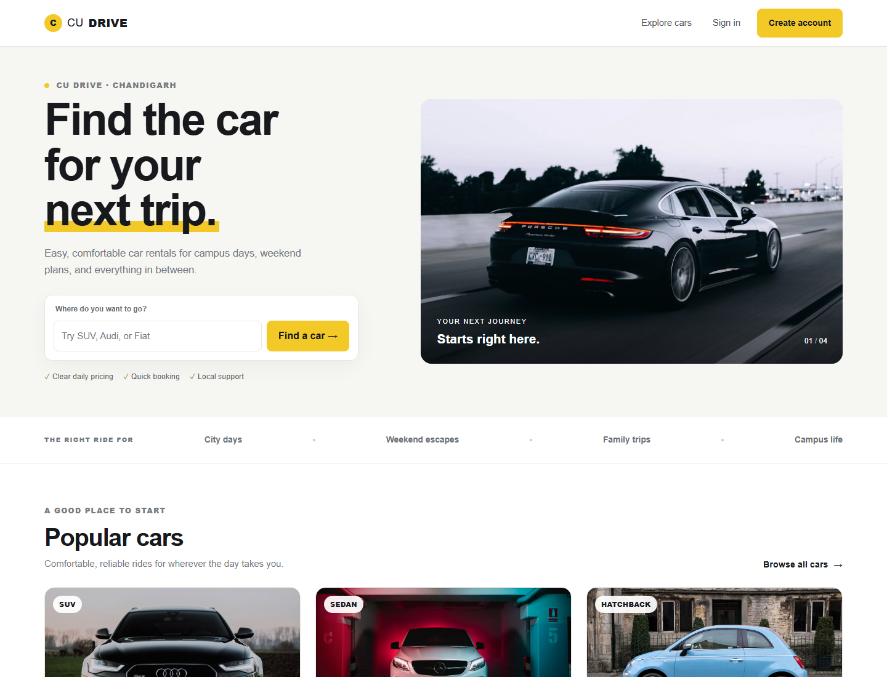
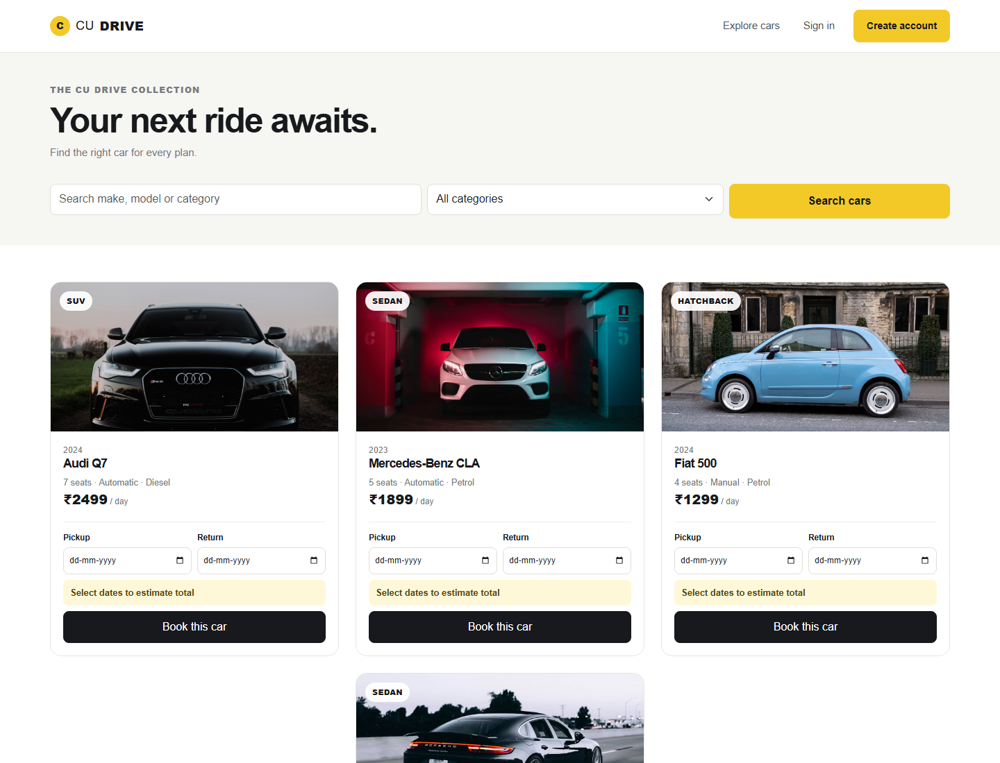
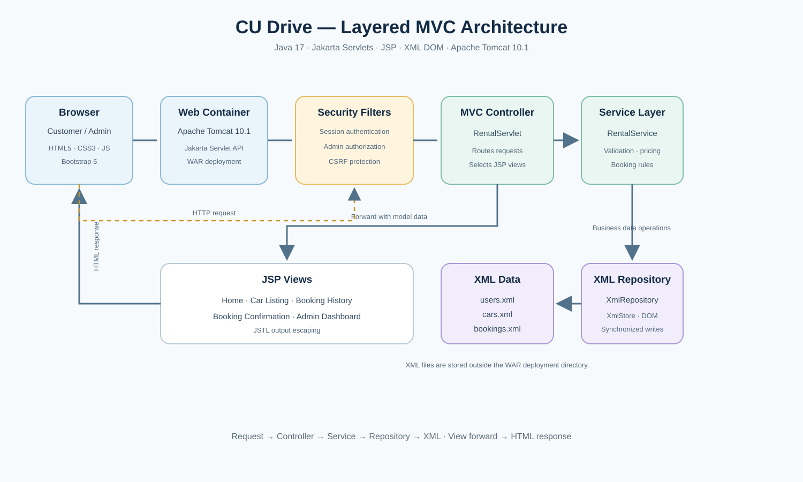

# CU Drive — Chandigarh University Car Rental Management System

A Java 17, Jakarta Servlet/JSP MVC Maven WAR project for Apache Tomcat 10.1. It uses DOM XML repositories instead of a database.

## Features

- Customer registration, PBKDF2-HMAC-SHA256 password hashing, login/logout, booking history and pending booking cancellation.
- Search/filterable fleet, vehicle specifications, date-based price estimates, overlap prevention and booking confirmation.
- Role-protected admin dashboard, booking approval/rejection/completion, customer directory, car create/update/delete and availability control.
- Session authentication, session ID rotation at login, CSRF token validation on POSTs, escaped JSP data output, restrictive response headers and XXE-hardened XML parsing.
- Synchronized repository operations and atomic file replacement for XML writes.

## Requirements

- JDK 17+
- Maven 3.8+
- Apache Tomcat 10.1.x

## Build and run locally

1. Set a writable data directory outside the deployment folder (recommended):
   - PowerShell: `$env:CAR_RENTAL_DATA = "$env:USERPROFILE\car-rental-data"`
   - Or pass Tomcat JVM option `-Dcarrental.data.dir=C:/data/car-rental`.
2. From the project root run `mvn clean package`.
3. Copy `target/car-rental.war` to Tomcat's `webapps` directory and start Tomcat.
4. Open `http://localhost:8080/car-rental/`.
5. On first launch the app initializes `users.xml`, `cars.xml`, and `bookings.xml` in the configured data directory. Existing files are preserved.

## Start the system on Windows

Double-click `start.bat`. It checks for Java 17, builds the WAR with Maven when Maven is available, and deploys it to Tomcat. If `CATALINA_HOME` is not set and a project-local Tomcat is not present, the launcher downloads Apache Tomcat 10.1.61 from the official Apache mirror and verifies the ZIP against Apache's SHA-512 checksum before extracting it. If Maven is not installed, it can use the already-built `target/car-rental.war`.

The first run needs an internet connection to download Tomcat. The app opens at `http://localhost:8080/car-rental/`. XML data is stored in `%USERPROFILE%\car-rental-data`, outside the WAR. Keep the Tomcat console window open while using the system; close it to stop the server. Sample accounts are listed above.

Sample sign-ins (change these before any shared or public deployment):

- Admin: `admin@admin` / `admin`
- Customer: `demo@demo` / `demo`

## Data files

XML files are created on first run at `%USERPROFILE%\car-rental-data` (Windows default) or `~/car-rental-data` (Unix default). `CAR_RENTAL_DATA` and `-Dcarrental.data.dir` override the default. The project also includes example schema-shaped XML in `data/`. Application writes are made to a temporary sibling and atomically moved into place. All DOM parsing disables DOCTYPE and external entities.

## MVC architecture

- `model`: `User`, `Car`, and `Booking` domain objects.
- `controller`: `RentalServlet` routes customer and admin requests; `SecurityFilter` provides CSRF/security headers; `AdminFilter` enforces administrator role.
- `service`: `RentalService` contains authentication, registration, availability/overlap, price and dashboard calculations.
- `repository`: `XmlRepository` reads and writes users, cars and bookings; `XmlStore` configures safe DOM parsing and persistence.
- `WEB-INF/views`: JSP views are inaccessible directly and are rendered by servlet controllers. JSTL `c:out` escapes user-managed content.

Booking flow: a customer signs in, chooses dates on a vehicle card, server validates dates and checks all active bookings for overlap while holding the repository lock, computes full-day price, persists a PENDING record, and shows confirmation. Admin approves/rejects it from the dashboard. Customers may cancel pending requests; admin can mark approved bookings completed.

## Screenshots

The screenshots are captured from the running Tomcat application. See [the workflow and architecture guide](docs/WORKFLOW.md) for the complete customer and administrator flows.

| Home page | Car fleet |
|---|---|
|  |  |

## Architecture diagram



## Functional testing checklist

1. Register a customer, sign out and sign back in; verify duplicate email is rejected.
2. Search the fleet and filter by category; confirm car specifications and price display.
3. Submit a valid booking and verify total = daily price × number of nights.
4. Try an end date on/before pickup and a past pickup; verify validation prevents booking.
5. Make a second booking for overlapping dates and the same car; verify it is blocked.
6. Verify booking appears in customer history and pending cancellation works.
7. Sign in as admin; verify dashboard metrics, customer list, car create/update/delete, and booking approve/reject/complete.
8. Submit a state-changing form without `_csrf`; verify HTTP 403.
9. Restart Tomcat and confirm XML data persists.
10. Inspect stored passwords and confirm only salted PBKDF2 values are present.

## Notes

Images use remote Unsplash URLs and require internet access; edit image URLs in the admin car form or XML for offline use. Tomcat must be configured with a writable data directory. This is an educational project; use HTTPS and rotate sample credentials before deployment outside a classroom.

## Project structure

```text
pom.xml
README.md
data/                         # example XML datasets
src/main/java/com/cu/carrental/
  controller/                 # servlet routes and security filters
  model/                      # User, Car, Booking
  repository/                 # DOM XML store and repository
  service/                    # rental business rules
  util/                        # PBKDF2 password utility
src/main/resources/           # empty XML templates packaged in the WAR
src/main/webapp/
  WEB-INF/web.xml
  WEB-INF/views/               # JSP pages and shared fragments
  assets/css/site.css
  assets/js/app.js
target/car-rental.war
```
