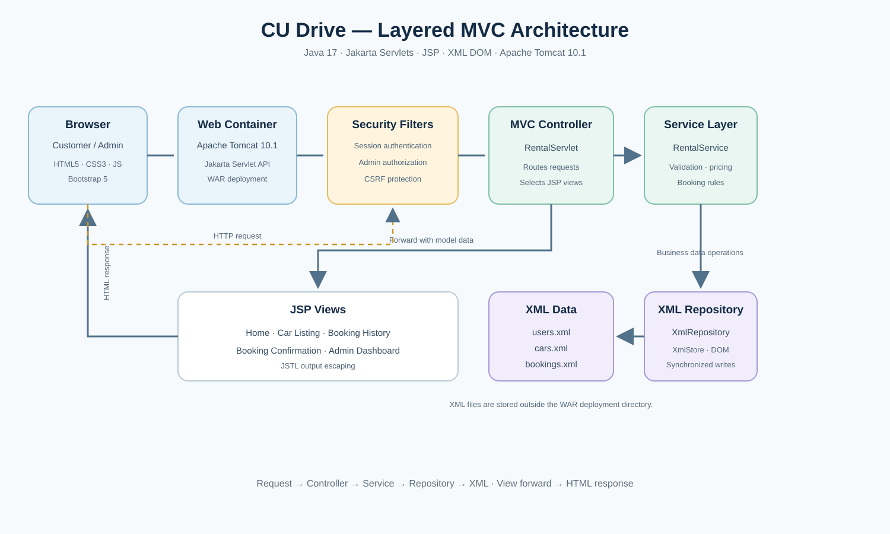
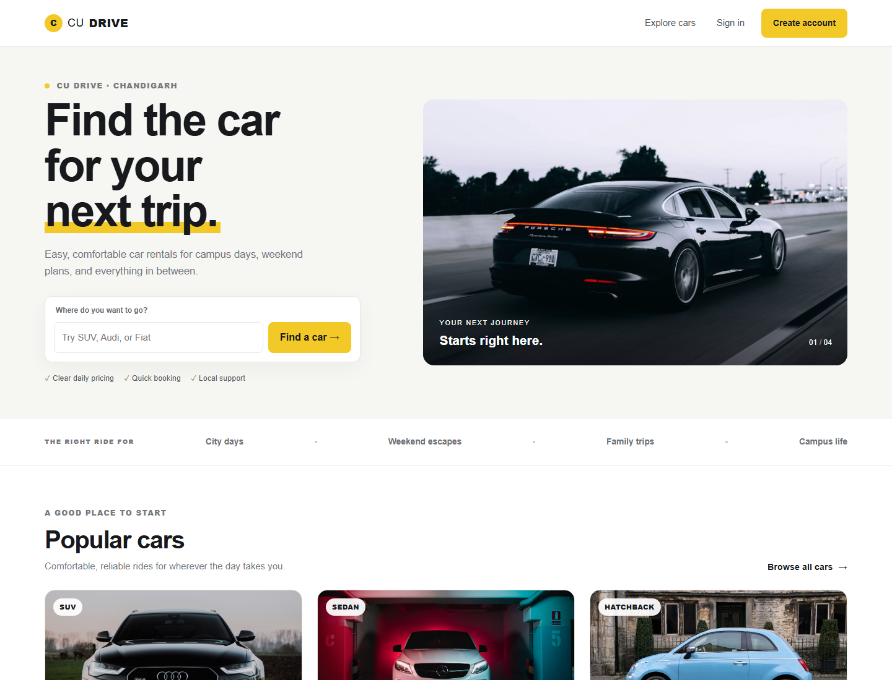
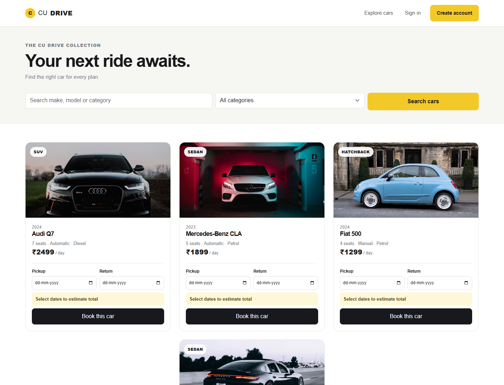
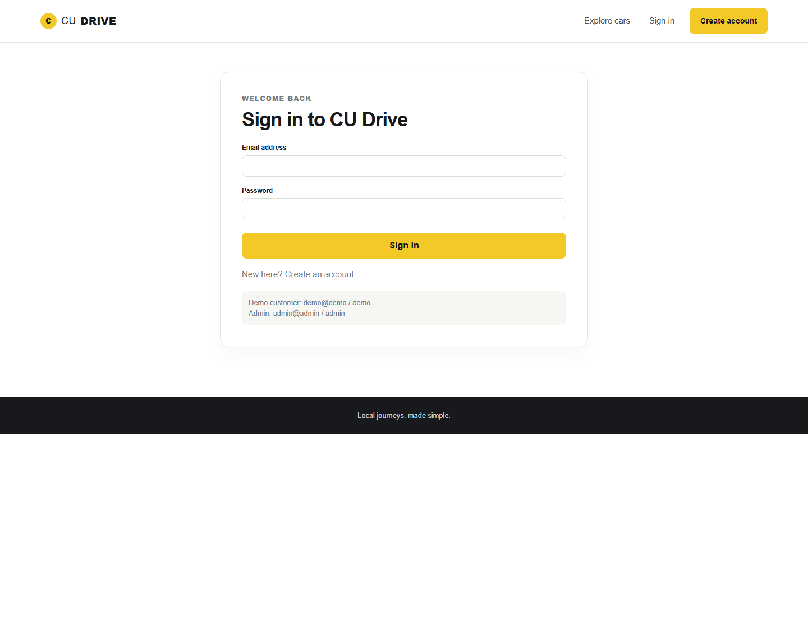

# CU Drive Workflow and Architecture

## Architecture



CU Drive uses MVC separation. The browser sends HTTP requests to Apache Tomcat. Servlet filters handle session security, administrator authorization and CSRF checks. `RentalServlet` selects the service operation and JSP view. `RentalService` validates application rules and delegates data access to the XML repository. The JSP renders the response with escaped output.

## Customer workflow

1. The customer browses the home page and searches or filters the car fleet.
2. The customer selects a car and pickup/return dates. The browser estimates the rental cost.
3. The customer signs in or creates an account. Passwords are saved as salted PBKDF2 hashes.
4. The booking request reaches `RentalServlet`, then `RentalService` validates the dates and checks overlapping bookings for that car.
5. The service calculates the full-day total and saves a `PENDING` booking through `XmlRepository` / `XmlStore`.
6. The confirmation JSP displays the booking. The customer can review or cancel pending bookings in booking history.

## Administrator workflow

1. The administrator signs in. `AdminFilter` permits `/admin/*` only for a user with the `ADMIN` role.
2. The dashboard reads car, customer, booking and approved-revenue data from the service layer.
3. The administrator can create or update cars, change availability, delete cars, view customers, and approve, reject or complete bookings.
4. Each state-changing form includes the session CSRF token. The servlet validates the requested operation before calling the service or repository.

## XML persistence workflow

`XmlRepository` maps XML elements to `User`, `Car` and `Booking` model objects using the DOM parser. `XmlStore` disables DOCTYPE and external entities. Writes are synchronized, written to a temporary sibling file, then atomically moved into place when supported. Runtime XML is written outside the WAR folder, by default to `%USERPROFILE%\car-rental-data` on Windows.

## Request path

```text
Browser → Tomcat → SecurityFilter / AdminFilter → RentalServlet
       → RentalService → XmlRepository → XmlStore → external XML
       → JSP view → HTML response → Browser
```

## Screenshots

Screenshots below are captured from the running Tomcat application and show the customer home page, searchable fleet, and sign-in page.

To refresh them on Windows, start the app, then run the following from the project root (with Chrome installed):

```powershell
$chrome = "$env:ProgramFiles\Google\Chrome\Application\chrome.exe"
$profile = Join-Path $env:TEMP 'cu-drive-screenshot-profile'
$screens = 'docs\screenshots'
& $chrome --headless=new --disable-gpu --hide-scrollbars --window-size=1440,1100 --virtual-time-budget=7000 "--user-data-dir=$profile" "--screenshot=$screens\home.png" 'http://localhost:8080/car-rental/'
& $chrome --headless=new --disable-gpu --hide-scrollbars --window-size=1440,1100 --virtual-time-budget=7000 "--user-data-dir=$profile" "--screenshot=$screens\fleet.png" 'http://localhost:8080/car-rental/cars'
& $chrome --headless=new --disable-gpu --hide-scrollbars --window-size=1440,1100 --virtual-time-budget=7000 "--user-data-dir=$profile" "--screenshot=$screens\login.png" 'http://localhost:8080/car-rental/login'
```

### Home page



### Car fleet and booking controls



### Sign-in and demo account information


